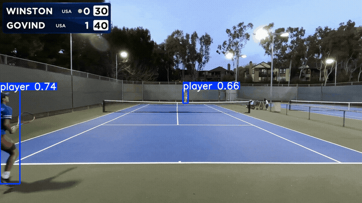
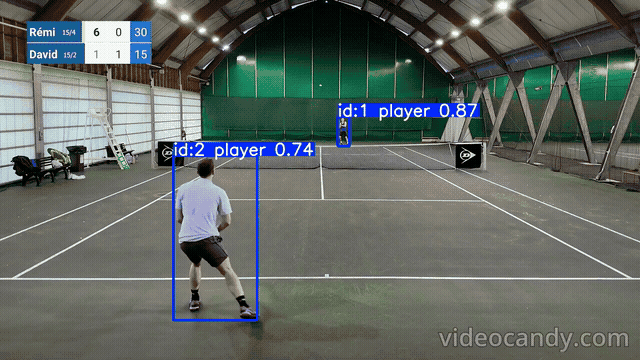
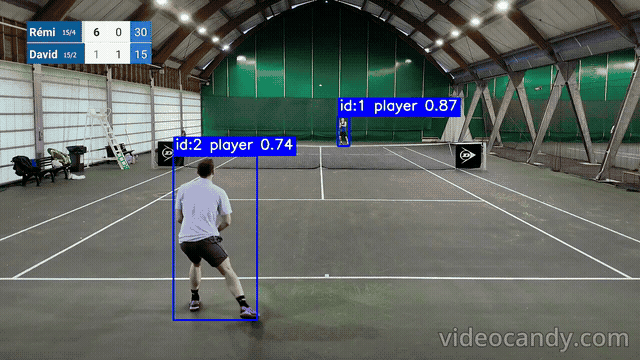

# TennisVision

TennisVision is an ongoing modular sports Computer Vision project for tennis broadcast analysis. It focuses on player detection, image and video inference, tracking, model evaluation, and experiment tracking.

## Documentation

The [`docs/` folder](docs/README.md) contains setup instructions, project architecture,
development and testing guidance, task usage guides, and experiment histories with
model comparisons and iteration notes. Start with the [documentation index](docs/README.md)
or [setup guide](docs/getting-started.md).

| Area | Guide | Experiment record |
| --- | --- | --- |
| Shot classification | [Training, evaluation, and API](docs/tasks/shot-classification.md) | [Workflow and recording conventions](docs/experiments/shot-classification.md) |
| Player detection | [Inference and training](docs/tasks/detection.md) | [Datasets, runs, and results](docs/experiments/detection.md) |
| Video tracking | [Tracking and postprocessing](docs/tasks/video-tracking.md) | [Iterations and clip reviews](docs/experiments/video-tracking.md) |

See [project architecture](docs/architecture.md) for module responsibilities and
[development](docs/development.md) for tests, CI, and contribution conventions.

The project currently includes:

- shot classification
- YOLO-based player/object detection
- image inference and visualization
- FastAPI inference APIs
- MLflow experiment tracking
- video player tracking with ByteTrack
- tracking postprocessing for ID cleanup, duplicate merging, re-entry stitching, and active-player selection

## Demo / Visual Preview

Example tracking output:



Postprocessing example on a harder clip:

| Raw tracking | After postprocessing |
| --- | --- |
|  |  |

Postprocessing is a core part of the tracking methodology, not just a visualization cleanup step. Tennis videos require handling ID switches, short noisy tracks, duplicate identities, players leaving and re-entering the frame, neighboring-court players, staff/ball-kid false positives, and perspective-dependent active-player selection. The example above shows one representative case where postprocessing improves identity consistency after a difficult tracking event. Larger videos and local MLflow artifacts are intentionally not committed to the repository.

Demo GIFs are short processed clips with TennisVision overlays; source details are listed in [Third-Party Notices](THIRD_PARTY_NOTICES.md).

## Quick start

```bash
uv sync --locked --extra dev
make check
```

Training and inference need the datasets/models described in the task guides.
Current work focuses on tracking evaluation, followed by court localization and
player-coordinate mapping. The repository currently implements image classification,
player detection, video tracking, postprocessing, and task-specific inference APIs.
